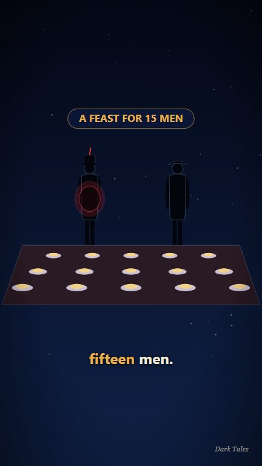
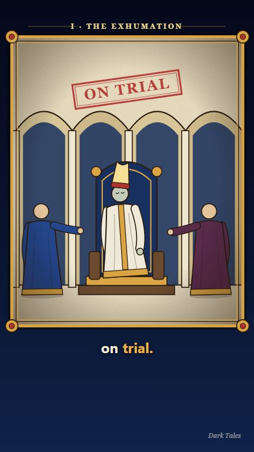
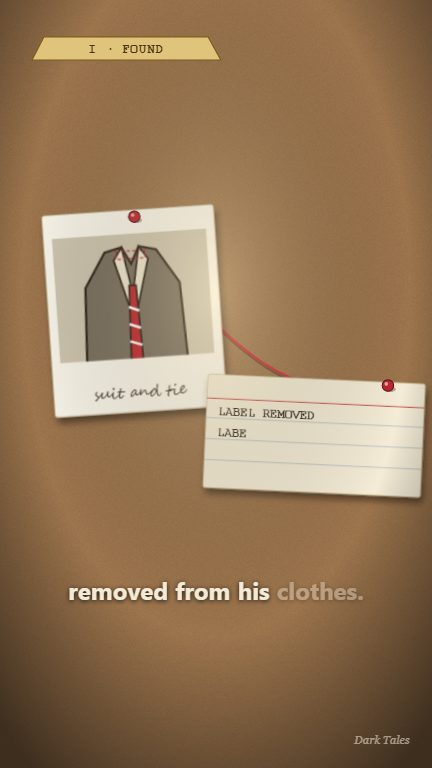
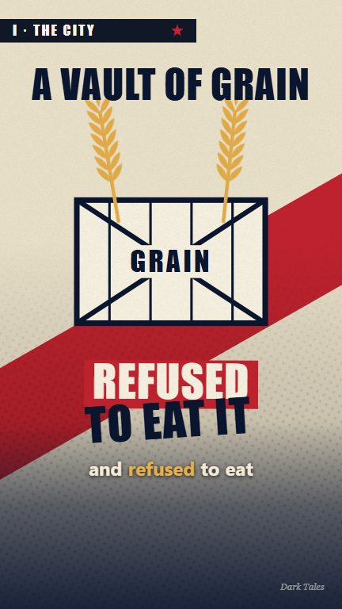

# Dark Tales

**A data-driven motion-graphics engine for short-form "dark true story" videos.**
Write an episode as a JSON file. Get a vertical (1080x1920) video with animated visuals, word-synced
subtitles, a voice-over and sparse sound design, ready for YouTube Shorts, Reels or TikTok.

[](LICENSE)
[](https://www.remotion.dev)

> **Heads up before you use it:** the code in this repo is MIT, but it runs on [Remotion](https://www.remotion.dev),
> which has its **own license** (free for individuals and companies of up to 3 people, a paid company license for
> larger for-profit organizations). Read [Licensing](#licensing) first.

| `night` | `manuscript` | `casefile` | `poster` |
|:--:|:--:|:--:|:--:|
|  |  |  |  |
| silhouettes, slow camera pushes | illuminated folios that slide like a scroll | polaroids, typewriter text, red string | giant kinetic type, diagonal wipes |

Four **looks** (visual languages) share one brand, one timing system and one audio philosophy, so a channel can
vary its presentation from episode to episode without losing its identity.

## What you get

- **Episodes are data.** A script, its shots and its sound cues live in one `episode.json`. No animation code per video.
- **Timed to spoken words, not seconds.** Cues like `"@secret"` fire when the narrator says "secret". Re-record the
  voice and everything still lines up.
- **Word-synced subtitles** (3-4 words at a time, spoken words bright, keywords highlighted) from the voice-over's word timings.
- **Sound design rules baked in:** voice leads, a quiet music bed, sparse and soft effects that can never stack.
- **A quality gate** (`npm run ep -- check`) that catches broken cues, shots that flash by too fast, stacked sound
  effects, over-long episodes and unverified sources before you render.
- **Localisation:** per-episode language, brand text and narrator voice (see [docs/localization.md](docs/localization.md)).
- **Extensible:** add a shot type or a whole new look ([docs/creating-a-look.md](docs/creating-a-look.md)).

## Quick start

Requirements: **Node.js 20.19+ / 22.13+ / 24+** and a Chromium-capable machine (Remotion downloads its own browser on first render).

```bash
git clone <your-fork-or-this-repo>
cd dark-tales
npm install
cp .env.example .env        # only needed for voice-over / sound-effect generation
npm run ep -- lint all      # structural check of every example episode (no audio or API key needed)
```

### Preview an example episode without any audio

```bash
npm run ep -- draft tarrare   # writes ESTIMATED word timings (free, no API)
npm run dev                   # opens Remotion Studio; pick the composition "DarkTales-tarrare"
```

You get the full visuals and subtitles; the preview is silent because generated audio is not part of the repo
(see [Audio and assets](#audio-and-assets)). The console may log audio-load warnings: that is expected. On Windows
PowerShell, if scripts are blocked, use `npm.cmd` / `npx.cmd`.

### Make your own episode

```bash
npm run ep -- new my-story "My Story"   # scaffolds public/episodes/my-story/episode.json and registers it
# 1. write the voice-over text and shots (docs/episode-format.md)
npm run ep -- lint my-story             # structural check, instant
npm run ep -- draft my-story            # estimated timings so you can preview
npm run dev                             # judge the pacing in Remotion Studio
npm run ep -- voice my-story            # record the narration with ElevenLabs (spends credits, needs a key)
npm run ep -- check my-story            # full check against real timings and assets
npm run ep -- render my-story           # out/my-story/my-story.mp4 + publish.txt
```

Full walkthrough: [docs/getting-started.md](docs/getting-started.md).

## Project structure

```
.
├── public/
│   ├── episodes/<id>/episode.json   the scripts (committed). vo-*.mp3 / timings.json appear here when you run `voice` (git-ignored)
│   └── audio/                       sound effects and music (generated locally, git-ignored)
├── src/
│   ├── Root.tsx                     one Remotion composition per episode id
│   ├── episodes.ts                  the episode registry (`ep new` edits it)
│   ├── brand/brand.json             the single source of truth for the brand (colours, fonts, subtitles, audio levels, limits, voice)
│   └── engine/
│       ├── Episode.tsx              turns an episode + its timings into a video (shots, subtitles, audio)
│       ├── cue.ts, env.ts, types.ts word-cue resolver, shared context, the episode schema (TypeScript types)
│       ├── kit.tsx                  shared drawing parts: people, chips, stamps, map, globe, id cards...
│       ├── library.tsx              the `night` look (scene, globe, idcard, map, paper, sketch, object, cta)
│       └── manuscript.tsx, casefile.tsx, poster.tsx   the other three looks
├── scripts/
│   ├── episode.mjs                  the episode CLI (lint, new, draft, voice, check, render...)
│   ├── generate-audio.mjs           sound effects / music via ElevenLabs
│   └── make-bgm.mjs                 a free, original, procedural music bed (no key needed)
├── templates/episode.template.json  what `ep new` starts from
├── docs/                            guides (see below)
└── .claude/skills/dark-tales-episode  an optional Claude Code skill that drives the whole workflow
```

## Commands

| Command | What it does |
|---|---|
| `npm run dev` | Remotion Studio (live preview). |
| `npm run ep -- lint <id\|all>` | Structural check: cue words exist in the script, shot types match the look, required metadata. No audio or key needed. Run in CI. |
| `npm run ep -- new <id> "Title"` | Scaffold an episode and register it. |
| `npm run ep -- draft <id>` | Estimated timings for a free preview (renders are blocked until real timings exist). |
| `npm run ep -- voice <id> [--force]` | Narration per scene + word timings via ElevenLabs. Skips files that exist. |
| `npm run ep -- check <id>` | Full check against real timings and assets. |
| `npm run ep -- render <id> [--name=file]` | Check, then render to `out/<id>/`. Also writes `publish.txt` (title, description, hashtags, sources). |
| `npm run audio:sfx` | Generate the 12 shared sound effects (ElevenLabs). |
| `npm run audio:bgm` | Generate a free local music bed (`public/audio/bgm-local.wav`). |
| `npm run lint` / `npm run typecheck` | ESLint + TypeScript. |

## Configuration

- **Brand:** edit [`src/brand/brand.json`](src/brand/brand.json): name, watermark, closing card text, colours, fonts, subtitle style, audio levels and limits, default voice. Every episode picks it up.
- **Secrets:** `.env` (git-ignored). `ELEVENLABS_API_KEY` is only needed for `voice` and `audio:sfx`. See [`.env.example`](.env.example).
- **Per episode:** `look`, `lang`, `brandText`, `voice`, `keywords`: see [docs/episode-format.md](docs/episode-format.md).

## Audio and assets

This repo ships **no generated audio, video or third-party media.** Voice-overs and sound effects are generated
with your own ElevenLabs account, and music can be generated locally for free. They are git-ignored on purpose:
the terms attached to AI-generated audio (and to the voices you pick) are between you and the provider, so each
person should generate their own under their own plan. Details and the exact commands: [docs/audio-and-assets.md](docs/audio-and-assets.md).

## Documentation

| Doc | For |
|---|---|
| [docs/getting-started.md](docs/getting-started.md) | Your first episode, step by step. |
| [docs/episode-format.md](docs/episode-format.md) | The episode JSON: cues, scenes, every shot type of every look. |
| [docs/writing-guide.md](docs/writing-guide.md) | Script structure, hooks, and the fact-check protocol. |
| [docs/architecture.md](docs/architecture.md) | How the engine works. |
| [docs/creating-a-look.md](docs/creating-a-look.md) | Add a shot type or a new look. |
| [docs/audio-and-assets.md](docs/audio-and-assets.md) | Voice, sound effects, music, and licensing of generated audio. |
| [docs/localization.md](docs/localization.md) | Making an episode in another language. |
| [docs/panduan-id.md](docs/panduan-id.md) | Panduan singkat berbahasa Indonesia. |

## Content responsibility

The example episodes are retellings of real history, written from the sources listed in each episode's
`meta.sources`, and several stories have contested details (the narration hedges them). The engine's checker warns
about unverified sources, but **you are responsible for the accuracy of anything you publish**. Re-check facts,
especially anything that may have changed since the episode was written.

## Licensing

- **This repository's code and documentation: [MIT](LICENSE)**, Copyright (c) 2026 Noel Christevent Mandak.
  The example episode scripts (`public/episodes/*/episode.json`) are original writing released under the same license.
- **Remotion is not covered by the MIT license above.** It is a dependency you install from npm; its source is not
  copied into this repo. Remotion has its own [license](https://github.com/remotion-dev/remotion/blob/main/LICENSE.md):
  free for individuals, for-profit organizations with up to 3 employees, non-profits and evaluation; **a paid
  Company License is required for other for-profit organizations.** It also forbids selling or relicensing a derivative
  of Remotion itself. Using this engine to make videos means you must comply with Remotion's terms. Check them for your situation.
- **Generated audio** (ElevenLabs) is governed by [ElevenLabs' terms](https://elevenlabs.io/terms) and by the license of the voice you select. Your plan may affect commercial use and attribution.
- **Fonts** are referenced by name (Georgia, Impact, Segoe UI, Courier New, Segoe Script) and **not bundled**. They come from the machine that renders; availability varies by OS.
- See [NOTICE.md](NOTICE.md) for the full third-party list. This is not legal advice.

*Not affiliated with or endorsed by Remotion or ElevenLabs. "Dark Tales" is just this project's example channel name; rename it in `brand.json`.*

## Contributing

Issues and pull requests are welcome: new looks, shot types, languages, better tooling. See [CONTRIBUTING.md](CONTRIBUTING.md).
